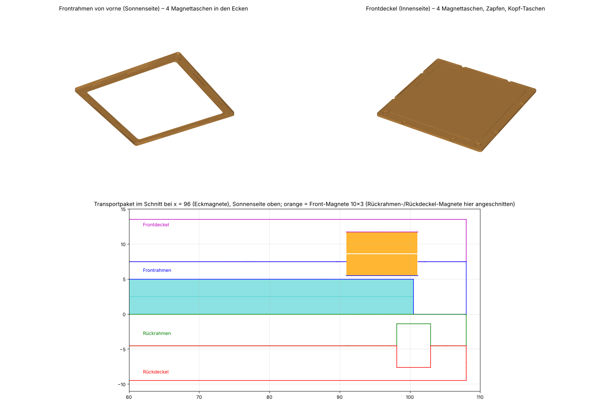
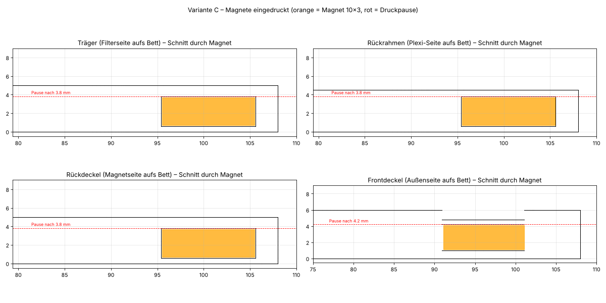
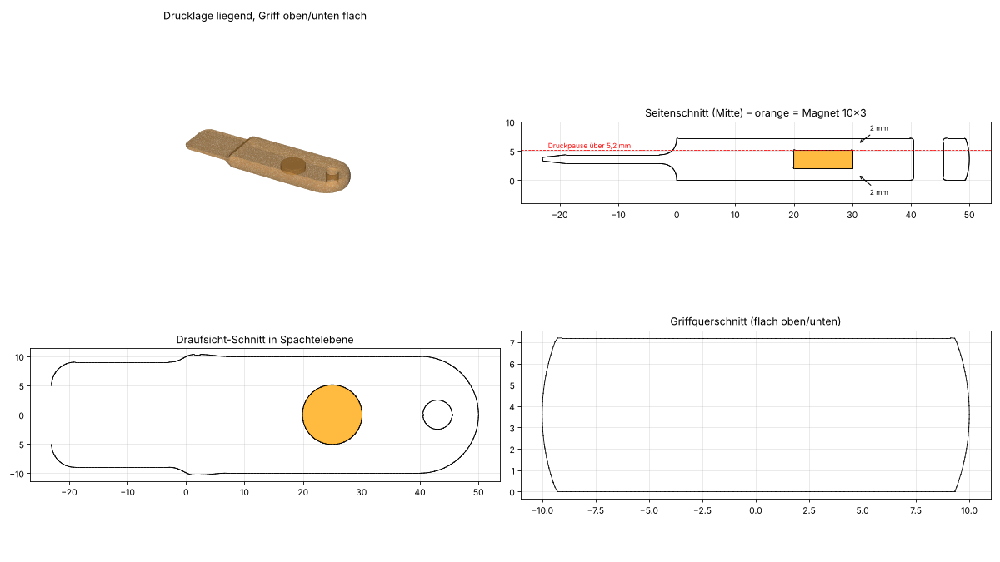

# Solarfilter-Aufsatz für Tamron 150-500 mm F5-6.7 Di III VC VXD (A057)

3D-druckbarer Halter für Solarfolie zwischen zwei Plexiglasplatten (200 × 200 mm, je 2 mm), aufgesteckt auf die
Original-Gegenlichtblende **HA057** (Außen-Ø vorne am Gummiring gemessen: 113,05 mm).
Das Filterpaket hält magnetisch am Träger und lässt sich für die Totalität mit einem Griff abnehmen.
Für den Transport haften Frontdeckel und Rückdeckel ebenfalls magnetisch am Filterpaket.

Autor: **Stefan J. Kaiser DM5CQ / OE8KKS** · Material: PETG-CF · Konstruktion mit Unterstützung von Claude (Anthropic)




## Drei Varianten

Alle Varianten sind vollständig und gleichwertig – sie unterscheiden sich nur darin, **wie die Neodym-Magnete
(Ø10 × 3 mm) in den Teilen sitzen**. Frontrahmen und Passring sind in allen Varianten identisch.

| | Variante A – Magnete außen | Variante B – Magnete innen | Variante C – Magnete eingedruckt |
|---|---|---|---|
| Ordner | [`variante_A_magnete_aussen`](stl/variante_A_magnete_aussen) | [`variante_B_magnete_innen`](stl/variante_B_magnete_innen) | [`variante_C_magnete_eingedruckt`](stl/variante_C_magnete_eingedruckt) |
| Träger, Rückrahmen | Taschen offen zur Trennfuge, Magnet bündig | Taschen offen nach außen (Kamera- bzw. Plexi-Seite), 0,6 mm Haut zur Trennfuge | geschlossene Hohlräume, rundum eingeschlossen |
| Rückdeckel, Frontdeckel | Taschen offen | Taschen offen | geschlossene Hohlräume |
| Magnete | einkleben | Rückrahmen eingeschlossen, sonst einkleben | **in Druckpause einlegen**, kein Kleben, nicht mehr entnehmbar |
| Haltekraft | maximal (Magnet auf Magnet) | etwas geringer (1,2 mm Abstand) | etwas geringer (1,3 mm Abstand) |
| Druck | beliebig | 0,2 mm Schichten | 0,2 mm Schichten + Druckpause |

### Variante C – Druckpausen

| Teil | Hohlraum (Höhe über Druckbett) | Pause vor der Schicht über |
|---|---|---|
| Träger | 0,6 – 3,8 mm | **3,8 mm** (bei 0,2 mm: Schicht 20 / 4,0 mm) |
| Rückrahmen | 0,6 – 3,8 mm | **3,8 mm** |
| Rückdeckel | 0,6 – 3,8 mm | **3,8 mm** |
| Frontdeckel | 1,0 – 4,2 mm | **4,2 mm** (Schicht 22 / 4,4 mm) |
| Frontrahmen | – (Lippe nur 2,5 mm dick: offene Tasche wie Variante B, Magnet einkleben, steht 1 mm vor) | – |

**Polung:** Alle Magnete vorher in einer Säule stapeln und die Oberseite jedes Magneten markieren.
In Träger, Rückrahmen, Rückdeckel und Frontdeckel jeweils mit der **Markierung nach unten** (zum Druckbett) einlegen,
im Frontrahmen mit der **Markierung nach außen** einkleben. Dann passt jede Kombination zusammen.
Kein Stahlwerkzeug verwenden; Magnete vollständig in die Taschen drücken, ein Tropfen Sekundenkleber verhindert,
dass eine Stahldüse sie beim Weiterdrucken anzieht.



## Teile (je Variante im Ordner `stl/variante_…`)

| Datei | Funktion | Drucklage |
|---|---|---|
| `solarfilter_traeger.stl` | bleibt auf der GLB: Flansch mit 8 Magnettaschen (A/B/C siehe oben) + U-Taschen für Muttern, geschlitztes Rohr Ø114,05 | Flansch aufs Bett |
| `solarfilter_frontrahmen.stl` | Sonnenseite, Tasche 201 × 201 × 5 mm für Plexi / Folie / Plexi, 4 Magnete in den Ecken | Sonnenseite aufs Bett |
| `solarfilter_rueckrahmen.stl` | hinterer Rahmen, 8 Magnettaschen (A/B/C siehe oben), Zentrierring | Plexi-Seite aufs Bett |
| `solarfilter_schutz_frontdeckel.stl` | Transportschutz vorne, magnetisch (4 Magnete), Zapfen im Fenster | Außenseite aufs Bett |
| `solarfilter_schutz_rueckdeckel.stl` | Transportschutz hinten, magnetisch | Magnetseite aufs Bett |
| `solarfilter_passring.stl` | nur Passprobe auf der GLB (wird nicht eingebaut) | beliebig |

Kein Stützmaterial nötig. PETG-CF → gehärtete Düse; 3–4 Wände, 10–25 % Infill. Druckbett ≥ 216 × 216 mm.

## Zusatztool: Hebelwerkzeug

Zum Abhebeln der Filtereinheit vom Träger: flacher Griff 20 × 7,2 × 50 mm mit Lanyard-Bohrung und eingedrucktem
Magnet (Ø10 × 3, je 2 mm Wand), Spachtel 18 × 23 × 1,5 mm mittig. Liegend gedruckt, 3MF mit eingebetteten
Einstellungen (100 % Infill, 6 Wände, Druckpause bei 5,4 mm für den Magneten) → [`zubehoer/hebelwerkzeug`](zubehoer/hebelwerkzeug)



## Zubehör

- 8 × M3x15 + 8 × M3-Mutter (Filterpaket verschrauben, Köpfe auf der Sonnenseite)
- 32 × Neodym-Magnet Ø10 × 3 mm, eingeklebt
  - 8 Träger + 8 Rückdeckel: alle **gleich** gepolt · 8 Rückrahmen: **Gegenpol** zur Trennfuge
  - 4 Frontrahmen (stehen 1 mm vor) + 4 Frontdeckel (sitzen unten in der 4,2 mm tiefen Tasche): zueinander **gegenpolig**
- Klettband für die Nut am Rohr (Sicherung gegen Abfallen)
- 2 × Plexiglas 200 × 200 × 2 mm, Solarfolie (z. B. Baader AstroSolar)

## Aufbau

Sonne → Frontrahmen → Plexi → Folie → Plexi → Rückrahmen ‖ *Magnet-Trennfuge* ‖ Träger → Gegenlichtblende → Objektiv

Transport: Frontdeckel ‖ Filterpaket ‖ Rückdeckel (oder statt Rückdeckel der Träger) – alles magnetisch.

## Anpassen

`solarfilter_gen.py` erzeugt alle STLs neu (nur `numpy`, `scipy`, `matplotlib`):

```
python3 solarfilter_gen.py stl/variante_A_magnete_aussen      A
python3 solarfilter_gen.py stl/variante_B_magnete_innen       B
python3 solarfilter_gen.py stl/variante_C_magnete_eingedruckt C
```

Wichtige Parameter oben im Skript: `GLB_D`, `SPIEL_D`, `STAPEL`, `MAG_D`/`MAG_H`, `SCHR_LAENGE`, `ZAPFEN_SP`.

## Versionen (Ordner `versionen/`)

| Version | Inhalt |
|---|---|
| v0 | Ausgangsmodell (Rahmen, Deckrahmen, Träger für Objektiv-Ø93) – als ZIP |
| v1 | Plexi-Folie-Plexi-Tasche 5 mm, Träger mit Flansch + Federzungen-Rohr für GLB Ø113,05, Passring |
| v2a | Magnet-Schnellwechsel: Rückrahmen mit 8 Magneten + Zentrierring, Einschmelzmuttern |
| v2b | M3x15 mit Muttern, U-Taschen im Träger, Flansch 5 mm |
| v3 | Transport-Schutzdeckel vorne (Klemmzapfen) und hinten (magnetisch) |
| v4 | Frontdeckel magnetisch: je 4 Magnete in Frontrahmen und Frontdeckel, Frontdeckel 6 mm – **= Variante A** |
| v5 | Magnettaschen Träger zur Kameraseite, Rückrahmen zur Innenseite (0,6 mm Haut) – **= Variante B** |

## Lizenz

[](https://creativecommons.org/licenses/by-nc-sa/4.0/deed.de)

**CC BY-NC-SA 4.0** – siehe [`LICENSE.md`](LICENSE.md). Nachbauen und Verändern erlaubt, mit Namensnennung
(Stefan J. Kaiser DM5CQ / OE8KKS), **nicht kommerziell** und Weitergabe nur unter gleichen Bedingungen.

## ⚠️ Sicherheit

Niemals ohne intakte, zertifizierte Solarfolie in die Sonne schauen oder fotografieren. Folie vor jedem Einsatz gegen
helles Licht auf Löcher prüfen. Das Plexiglas schützt nur mechanisch, es filtert nicht. Filter immer zusätzlich gegen
Abfallen sichern. Nutzung auf eigene Gefahr.
