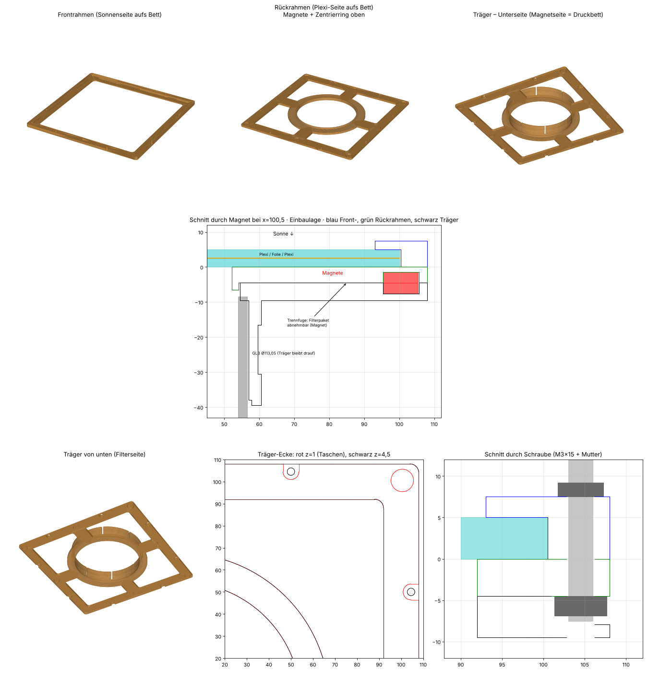

# Solarfilter-Aufsatz für Tamron 150-500 mm F5-6.7 Di III VC VXD (A057)

3D-druckbarer Halter für Solarfolie zwischen zwei Plexiglasplatten (200 × 200 mm, je 2 mm), aufgesteckt auf die
Original-Gegenlichtblende **HA057** (Außen-Ø vorne am Gummiring gemessen: 113,05 mm).
Das Filterpaket hält magnetisch am Träger und lässt sich für die Totalität mit einem Griff abnehmen.

Autor: **Stefan J. Kaiser DM5CQ / OE8KKS** · Material: PETG-CF · Konstruktion mit Unterstützung von Claude (Anthropic)



## Teile (Ordner `stl/`)

| Datei | Funktion | Drucklage |
|---|---|---|
| `solarfilter_traeger.stl` | bleibt auf der GLB: Flansch mit 8 Magnettaschen + U-Taschen für Muttern, geschlitztes Rohr Ø114,05 | Flansch aufs Bett |
| `solarfilter_frontrahmen.stl` | Sonnenseite, Tasche 201 × 201 × 5 mm für Plexi / Folie / Plexi | Sonnenseite aufs Bett |
| `solarfilter_rueckrahmen.stl` | hinterer Rahmen, 8 Magnete, Zentrierring | Plexi-Seite aufs Bett |
| `solarfilter_schutz_frontdeckel.stl` | Transportschutz vorne, Zapfen klemmt im Fenster | Außenseite aufs Bett |
| `solarfilter_schutz_rueckdeckel.stl` | Transportschutz hinten, magnetisch | Magnetseite aufs Bett |
| `solarfilter_passring.stl` | nur Passprobe auf der GLB (wird nicht eingebaut) | beliebig |

Kein Stützmaterial nötig. PETG-CF → gehärtete Düse; 3–4 Wände, 10–25 % Infill. Druckbett ≥ 216 × 216 mm.

## Zubehör

- 8 × M3x15 + 8 × M3-Mutter (Filterpaket verschrauben, Köpfe auf der Sonnenseite)
- 24 × Neodym-Magnet Ø10 × 3 mm (8 Träger, 8 Rückrahmen, 8 Rückdeckel), eingeklebt
  - Träger und Rückdeckel: alle Magnete **gleich** gepolt; Rückrahmen: **Gegenpol** außen
- Klettband für die Nut am Rohr (Sicherung gegen Abfallen)
- 2 × Plexiglas 200 × 200 × 2 mm, Solarfolie (z. B. Baader AstroSolar)

## Aufbau

Sonne → Frontrahmen → Plexi → Folie → Plexi → Rückrahmen ‖ *Magnet-Trennfuge* ‖ Träger → Gegenlichtblende → Objektiv

## Anpassen

`solarfilter_gen.py` erzeugt alle STLs neu (nur `numpy`, `scipy`, `matplotlib`):

```
python3 solarfilter_gen.py stl
```

Wichtige Parameter oben im Skript: `GLB_D`, `SPIEL_D`, `STAPEL`, `MAG_D`/`MAG_H`, `SCHR_LAENGE`, `ZAPFEN_SP`.

## Versionen (Ordner `versionen/`)

| Version | Inhalt |
|---|---|
| v0 | Ausgangsmodell (Rahmen, Deckrahmen, Träger für Objektiv-Ø93) – als ZIP |
| v1 | Plexi-Folie-Plexi-Tasche 5 mm, Träger mit Flansch + Federzungen-Rohr für GLB Ø113,05, Passring |
| v2a | Magnet-Schnellwechsel: Rückrahmen mit 8 Magneten + Zentrierring, Einschmelzmuttern |
| v2b | M3x15 mit Muttern, U-Taschen im Träger, Flansch 5 mm |
| v3 | Transport-Schutzdeckel vorne (Klemmzapfen) und hinten (magnetisch) – **aktuell** |

## Lizenz

[](https://creativecommons.org/licenses/by-nc-sa/4.0/deed.de)

**CC BY-NC-SA 4.0** – siehe [`LICENSE.md`](LICENSE.md). Nachbauen und Verändern erlaubt, mit Namensnennung
(Stefan J. Kaiser DM5CQ / OE8KKS), **nicht kommerziell** und Weitergabe nur unter gleichen Bedingungen.

## ⚠️ Sicherheit

Niemals ohne intakte, zertifizierte Solarfolie in die Sonne schauen oder fotografieren. Folie vor jedem Einsatz gegen
helles Licht auf Löcher prüfen. Das Plexiglas schützt nur mechanisch, es filtert nicht. Filter immer zusätzlich gegen
Abfallen sichern. Nutzung auf eigene Gefahr.
