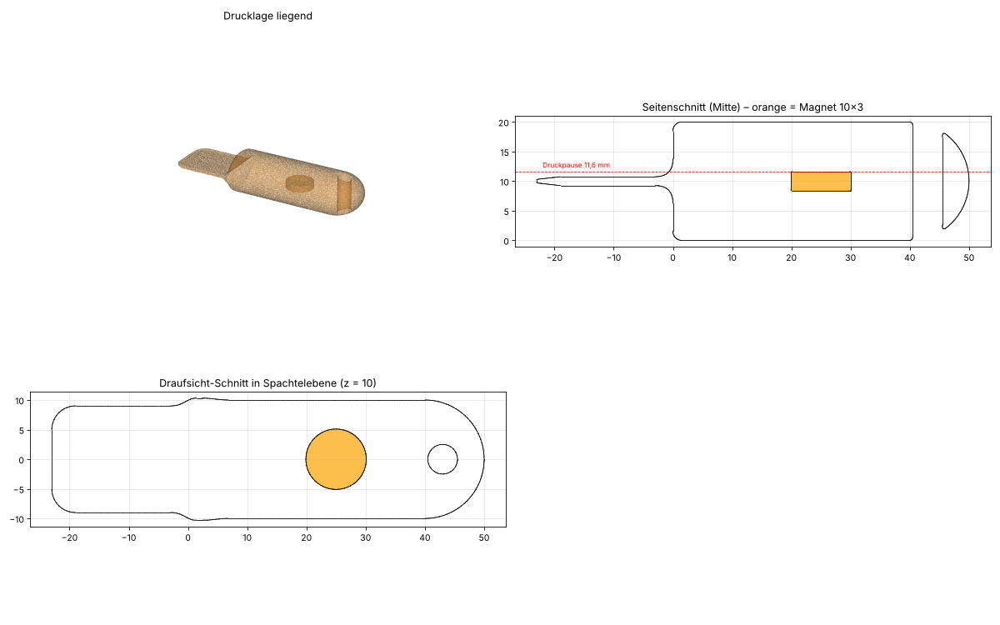

# Zusatztool: Hebelwerkzeug zum Ablösen der Filtereinheit

Kleines Spachtel-Werkzeug, um das magnetisch gehaltene Filterpaket vom Träger abzuhebeln.
Im Griff ist ein Neodym-Magnet (Ø10 × 3 mm) eingedruckt.



| Maß | Wert |
|---|---|
| Griff | Ø20 × 50 mm, hinten halbkugelig gerundet, vordere Kante R1,5 |
| Lanyard-Bohrung | Ø5 mm, 7 mm vor dem Griffende, senkrecht zur Spachtel |
| Spachtel | 18 × 23 × 1,5 mm, mittig auf der Griffachse, vordere Ecken R4 |
| Anschliff | beidseitig auf 0,6 mm über die vorderen 4 mm |
| Magnet | Ø10 × 3 mm, flach in der Spachtelebene, Griffmitte (Hohlraum Ø10,2 × 3,2) |
| Gesamt | 73 × 20,6 × 20 mm |

## Dateien

| Datei | Inhalt |
|---|---|
| `solarfilter_hebelwerkzeug.3mf` | **empfohlen** – Modell mit eingebetteten Druckeinstellungen und Druckpause (Bambu Studio, Orca Slicer, PrusaSlicer) |
| `solarfilter_hebelwerkzeug.stl` | reines Modell, Einstellungen manuell setzen |
| `hebelwerkzeug_gen.py` | Generator (numpy, scikit-image) |

## Druck – auf maximale Hebelkraft ausgelegt

- Drucklage **liegend** (so im Modell): Schichten laufen längs durch die Spachtel
- **Infill 100 %**, **6 Wände**, 8 Boden-/Deckschichten, Schichthöhe 0,2 mm
- Stützmaterial nur vom Druckbett (unter Griff und Spachtel)
- **Druckpause bei 11,8 mm** (erste Schicht über dem Hohlraum, Hohlraum z = 8,4–11,6 mm): Magnet flach einlegen,
  am besten mit einem Tropfen Sekundenkleber fixieren, kein Stahlwerkzeug verwenden
- In der 3MF ist das alles bereits eingetragen – nach dem Öffnen in der Vorschau kurz prüfen,
  ob Infill, Wände und Pause übernommen wurden
- PETG-CF eher am oberen Temperaturende drucken (bessere Schichthaftung)

## Anpassen

```
python3 hebelwerkzeug_gen.py solarfilter_hebelwerkzeug.stl
```

Erzeugt STL und 3MF. Parameter (Griff, Spachtel, Anschliff, Magnet, Lanyard, Druckeinstellungen `DRUCK`) oben im Skript.
